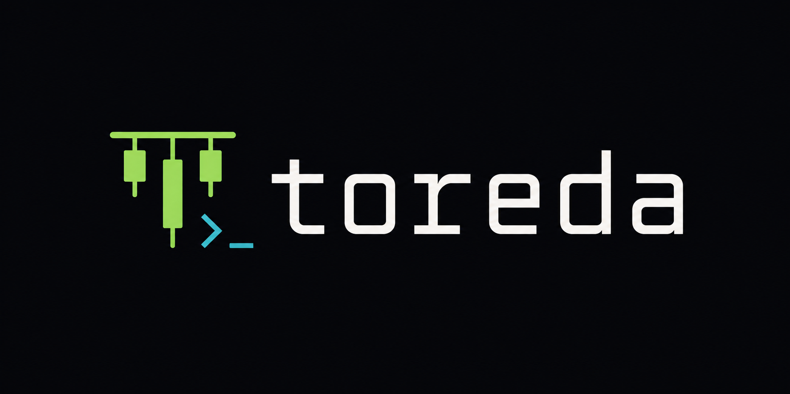
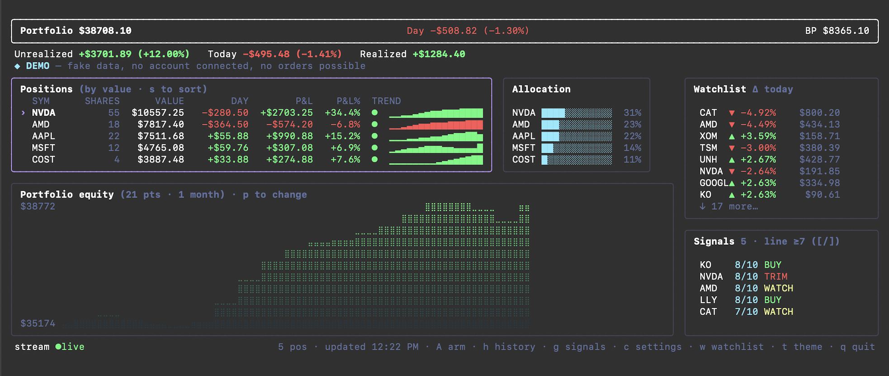

<div align="center">



### Your personal trading toolkit.

Live dashboard, opportunity scanner, and your own risk rules — for
[Alpaca](https://alpaca.markets) brokerage accounts.
Monitor your portfolio, place trades and scan for new opportunities.

</div>

---

<div align="center">
  
</div>

<div align="center">

[What is this?](#what-is-this) · [Features](#what-you-get) · [Getting started](#getting-started) · [The dashboard](#using-the-dashboard) · [Commands](#other-things-you-can-run)

[Claude Code](#optional-talk-to-it-with-claude-code) · [Briefings](#optional-briefings-on-your-phone) · [Safety](#how-toreda-keeps-you-safe) · [Docs](#learn-more) · [Disclaimer](#-please-read)

</div>

---

## What is this?

`toreda` watches the stocks you care about, tells you when something interesting
happens, and lets you act on it — all from one screen. It connects to your
Alpaca brokerage account, so the numbers are yours and the trades are real.

It is **not** a bot. It doesn't trade while you sleep, and it has no opinion it
won't show you the arithmetic for. You stay in charge of every decision; toreda
just makes sure you're deciding with good information in front of you.

---

## What you get

📊 **A live dashboard** — every position, profit and loss, allocation, and an
equity curve, updating in real time as prices move.

🔍 **An opportunity scanner** — checks your watchlist for momentum, pullbacks,
news catalysts and crowd sentiment, then ranks what it finds. It always shows
the arithmetic behind a score, so you can disagree with it.

🤖 **Optional Claude Code integration** — talk to your portfolio in plain
English, and have it argue _against_ your trade ideas before you place them.

🛡️ **Your own risk rules** — set a stop loss and a maximum position size once,
and every scan checks your holdings against them. A position that quietly grows
too large gets flagged even on a day nothing else happens.

⚡ **Trade without leaving the screen** — place buy and sell orders straight
from the dashboard, with a preview and a confirmation step before anything is
sent.

🔭 **Discovery** — finds liquid stocks that are moving but aren't on your list
yet, filtering out the penny stocks and leveraged products that clutter most
screeners.

📱 **Optional briefings** — a market summary at the open and close, delivered to
your terminal, a file, a desktop notification, or Telegram.

🎨 **Four colour themes**, and it works on macOS, Linux and Windows.

---

## Getting started

Three things to do once. Budget about fifteen minutes.

### 1. Install Node

Node is the engine toreda runs on — a free program from the people who make a
lot of the internet work. You need it the same way you need a PDF reader to open
a PDF.

👉 **Go to [nodejs.org](https://nodejs.org) and download the big green "LTS"
button.** Run the installer, click through it, done.

<details>
<summary>How do I know it worked?</summary>

Open your terminal — **Terminal** on a Mac (press `⌘ Space`, type "terminal"),
**Windows Terminal** on Windows — and type:

```bash
node --version
```

If it prints something like `v22.18.0`, you're set. If it says "command not
found", close the terminal, open a fresh one, and try again — installers often
need that.

You need version 22 or higher.

</details>

### 2. Get an Alpaca account

[Alpaca](https://alpaca.markets) is the broker toreda trades through. Signing up
is free.

1. Sign up at **[alpaca.markets](https://alpaca.markets)**
2. Switch to **Paper Trading** — the practice mode with fake money. **No deposit
   required.**
3. Find **API Keys** and click generate
4. Copy the **Key ID** and the **Secret Key** somewhere safe. The secret is only
   shown once.

> 💡 Paper and live accounts have **separate keys**. Mixing them up is the most
> common snag, and toreda will tell you if it happens.

### 3. Install toreda

Paste these into your terminal, one at a time:

```bash
# Download or Clone this repo
gh repo clone Adamhunter108/toreda
# Change into toredo directory
cd toreda
# install dependencies
npm install
# run setup wizard
npm run setup
```

Setup asks six questions and has a sensible answer for all of them — you can
press Enter through most of it:

|                    |                                                          |
| ------------------ | -------------------------------------------------------- |
| **Paper or live?** | Press Enter for paper (fake money)                       |
| **Your API keys**  | Paste them; toreda checks them with Alpaca immediately   |
| **What to watch**  | Press Enter for 25 well-known stocks across 8 industries |
| **Risk rules**     | Press Enter for sensible defaults                        |
| **Colour theme**   | Pick whichever looks nicest                              |

Then check everything's wired up:

```bash
npm run doctor
```

Green ticks are good. **Circles (`○`) are not errors** — they're optional
features you haven't set up yet.

**Stuck?** [docs/getting-started.md](docs/getting-started.md) walks through it
in more detail, with fixes for every error message toreda can produce.

---

## Using the dashboard

```bash
npm run dash
```

That's the main event. A wider terminal window gets you a richer layout — drag
it out before you start.

| Key     | Does                                                      |
| ------- | --------------------------------------------------------- |
| `↑` `↓` | Move around                                               |
| `tab`   | Jump between positions, watchlist, signals, and the chart |
| `space` | Expand the highlighted section to full screen, and back   |
| `enter` | Open a position — cost, charts, today's range             |
| `r`     | Run a scan for opportunities                              |
| `g`     | See all signals in detail                                 |
| `w`     | Add or remove stocks from your watchlist                  |
| `c`     | Adjust the scanner's sensitivity                          |
| `t`     | Change colour theme                                       |
| `p` `s` | Change the chart period / sort the positions              |
| `h`     | Order history                                             |
| `q`     | Quit                                                      |

### Trading from the dashboard

Trading is **switched off** when the dashboard opens. That's deliberate — you
can browse, scan and poke around with no chance of sending anything.

When you actually want to trade:

1. Press **`shift`+`A`** to arm it. A red **● TRADING ARMED** banner appears so
   there's no ambiguity.
2. Highlight a stock and press **`o`** to open an order ticket.
3. Fill in buy or sell, how many shares, market or limit.
4. toreda shows you the estimated cost, your available cash, and warns you if
   the trade would make a position bigger than your own rules allow.
5. To send it, **type the ticker symbol out in full** and press enter.

That last step is on purpose: no single keypress can ever place an order.

Press `shift`+`A` again to disarm.

> You can also trade from the command line:
>
> ```bash
> npm run toreda -- order NVDA buy 5             # shows a preview, sends nothing
> npm run toreda -- order NVDA buy 5 --confirm   # actually places it
> ```

---

## Other things you can run

```bash
npm run toreda -- portfolio      # what you own, and how it's doing
npm run toreda -- scan           # what's worth looking at today
npm run toreda -- quote NVDA     # a live price
npm run toreda -- watchlist      # everything you track, biggest movers first
npm run toreda -- brief          # a market summary
npm run toreda -- history        # past orders
```

Run `npm run toreda` on its own to see everything.

<details>
<summary>Tired of typing <code>npm run toreda --</code>?</summary>

Run this once:

```bash
npm link
```

Now every command works as just `toreda portfolio`, `toreda scan`, and so on.

</details>

---

## Optional: talk to it with Claude Code

If you use [Claude Code](https://claude.com/claude-code), open it inside the
toreda folder and it picks everything up automatically — including a rule that
**it can never place a trade without you explicitly asking.**

| Type this           | And it will                                                                             |
| ------------------- | --------------------------------------------------------------------------------------- |
| `/morning`          | Tell you where you stand: rule breaches first, then your book, then what's worth a look |
| `/analyze NVDA`     | Dig into one stock — the case for it, and an equally long case against                  |
| `/review`           | Check every position against your stops and size limits                                 |
| `/trade NVDA buy 5` | Walk you through a trade, argue the other side, then journal it                         |

There's also a **bear-case reviewer** whose only job is to talk you out of a
trade. It exists because anyone who's decided to buy something goes looking for
reasons it'll work — and finds them.

**None of this is required.** Everything above works perfectly without it.

---

## Optional: briefings on your phone

A market summary at the open and close, wherever you want it:

```bash
npm run toreda -- brief                    # prints to your terminal, no setup
npm run toreda -- setup briefings          # guided setup for Telegram
npm run toreda -- schedule install         # run automatically on weekdays
```

The Telegram setup handles the fiddly part for you — you make a bot, send it a
message, and toreda figures out the rest and sends a test message so you know
it worked.

Times are converted to **your** local timezone automatically, so a market-open
briefing arrives at the market open no matter where you live.

More in [docs/briefings.md](docs/briefings.md).

---

## How toreda keeps you safe

- **Practice money by default.** Real trading requires deliberately switching.
- **Two steps for every order.** A preview that sends nothing, then a separate
  confirmation.
- **The dashboard starts disarmed**, and still makes you type the ticker.
- **It refuses impossible trades** — selling shares you don't have, buying with
  money you don't have, ordering something it can't price.
- **Your rules are checked every scan**, even on quiet days.
- **It fails loudly, never quietly.** If it can't reach your account it says so,
  rather than showing an empty screen that looks like you own nothing.
- **Your keys never leave your machine.** They live in one file, readable only
  by you, and nothing prints them.

---

## Learn more

|                                                      |                                                   |
| ---------------------------------------------------- | ------------------------------------------------- |
| [Getting started](docs/getting-started.md)           | The long version, with troubleshooting            |
| [Building a watchlist](docs/building-a-watchlist.md) | What to track, and the trap most people fall into |
| [How the scanner works](docs/scanner.md)             | Every signal type and setting explained           |
| [Briefings](docs/briefings.md)                       | Scheduled summaries and delivery options          |
| [Data sources](docs/data-sources.md)                 | Where the numbers come from                       |
| [Trading plan template](templates/trading-plan.md)   | Write down your own rules                         |

---

## ⚠️ Please read

**toreda is not financial advice and gives no recommendations.** It is a tool
for organising your own decisions.

The scanner's confidence scores are a **ranking aid, not a prediction**. They
are not backtested, not calibrated, and an 8/10 means "look at this first" — not
"80% likely to work".

**Trading involves real risk of loss, including losing everything you put in.**
Start on paper. Stay on paper until you're bored of it. Never trade money you
need.

Provided as-is, with no warranty of any kind. See [LICENSE](LICENSE).

---

<div align="center">

**toreda** (トレーダー) — _trader_

MIT licensed

</div>
